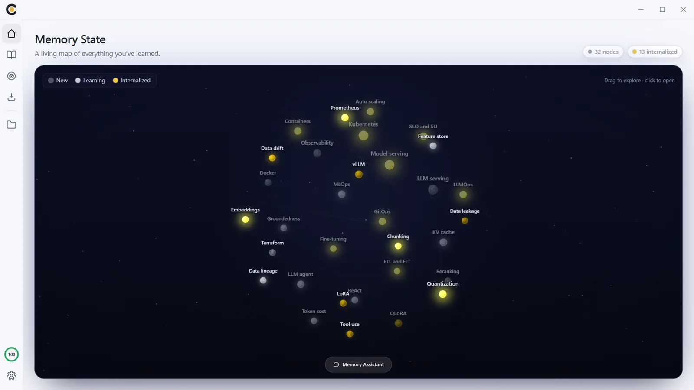
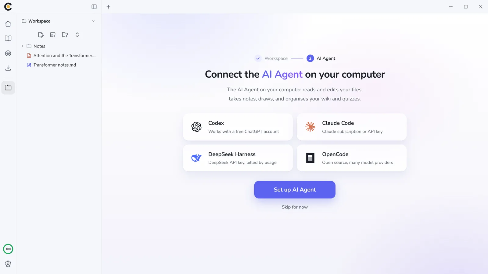
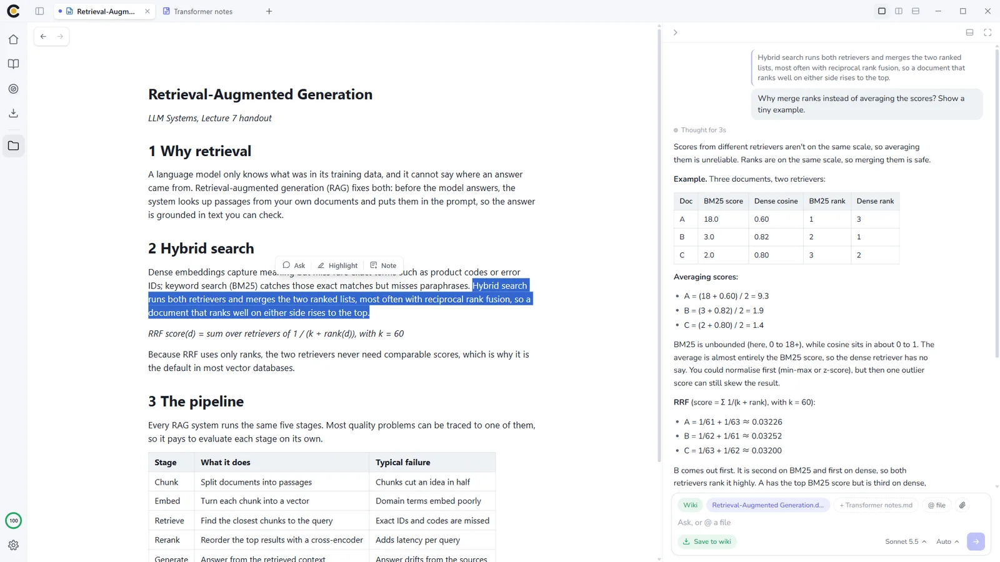
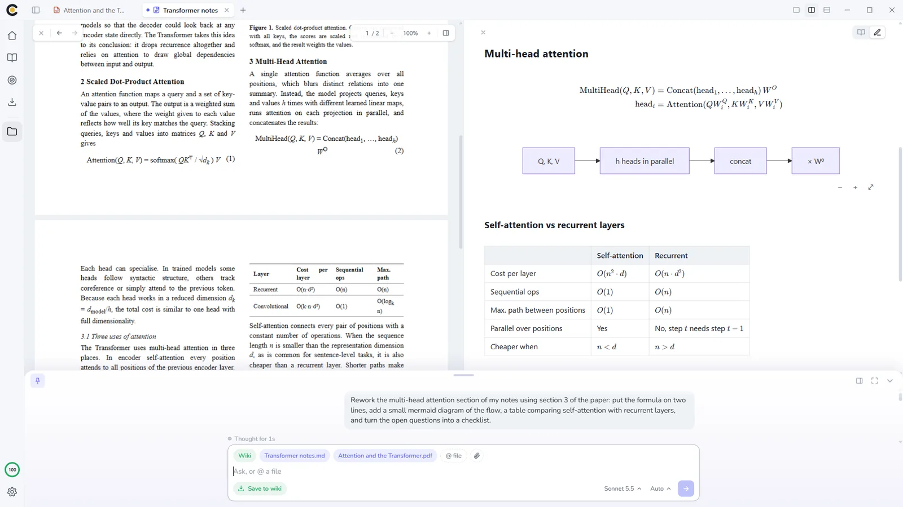
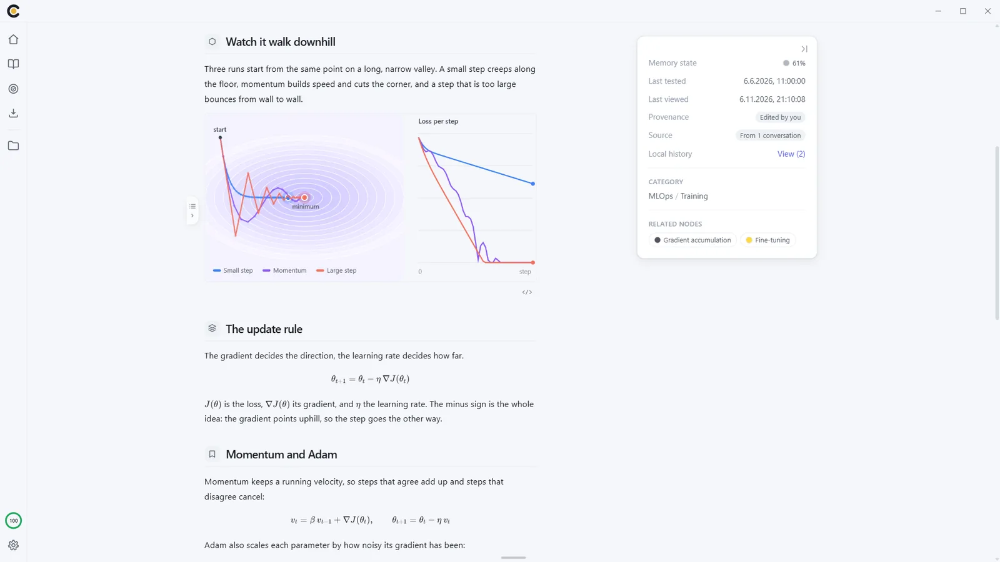
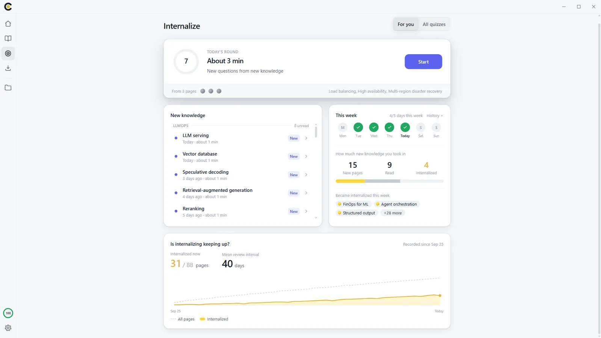

  

<h1 align="center">Eigma for desktop</h1>

  Read, ask your AI Agent and take notes in one window. 
  What you learn goes into a personal wiki that quizzes you before you forget it.

  <a href="https://apps.microsoft.com/detail/9NKV2P2G61MM">Get it from the Microsoft Store</a> ·
  <a href="https://eigma.app">eigma.app</a> ·
  <a href="https://github.com/eigma-app/eigma-desktop/issues">Report a bug</a>

Your wiki is a slowly turning galaxy. Every page is a star: gray when captured, silver once read, gold once you answer its quiz from memory. Pages dim as you are about to forget them, so one look shows you where to go next.

This repository holds the README, screenshots and issue tracker for the Eigma desktop app.
The app is free. Its source code is not published here.

## Your AI Agent, built in

Connect the coding agent you already use and it works inside Eigma:

- **Claude Code**
- **Codex**
- **OpenCode**
- **DeepSeek Harness**

The agent sees the document you have open. Eigma gives it tools to open your files and wiki pages, draw diagrams, and file what you learned into your wiki. You approve every change before it lands.

Eigma does not include a model and does not charge for one. The agent runs on your own account: Claude Code needs a paid Claude plan or an API key, and Codex works on ChatGPT Free with a small allowance.

## Read anything

PDF, Word, Excel, CSV, web pages, code, images, video and audio open beside your notes. Select a passage in any of them and ask your AI Agent about it.

- PDF: outline, highlights and notes, resumes where you left off
- Web pages open in tabs inside the app and can be saved to your workspace
- Video and audio play from disk, with a clickable transcript when a subtitle file sits beside them

## Notes and drawings

A Markdown editor with tables, formulas (KaTeX), Mermaid diagrams and `[[links]]` between notes and files. Excalidraw drawings live in the same workspace, and the agent can draw them for you.

## A wiki you actually remember

Each wiki page covers one topic. New material goes to the chapter where it belongs, and updates are added to the pages you already have instead of replacing them. Every page carries a few short quizzes that come back right before you are likely to forget.

## Recall it before it fades

Reading takes a page to silver; recalling it takes it to gold. Each day the Internalize screen gives you a short round of quizzes that are due, and shows what you took in this week and whether your memory is keeping up.

## Also works with ChatGPT and Claude

Connect ChatGPT or Claude, then say "organize this into Eigma" in any conversation. The lasting knowledge becomes wiki pages in your inbox, ready for you to accept. Setup: [eigma.app/connect](https://eigma.app/connect)

## Your data

- Works without an account. Then everything stays on this computer.
- Sign in with Google, GitHub or an Eigma account for a free cloud backup and sync with the [web app](https://my.eigma.app) and the [Android app](https://play.google.com/store/apps/details?id=com.eigma.app).
- No ads, no tracking, and no model is ever trained on your knowledge.

## Requirements

- Windows 10 (version 2004 or later) or Windows 11
- For the AI Agent: one of the agents above, installed and signed in

macOS and Linux versions are planned.

## Feedback

Found a bug or missing a feature? [Open an issue](https://github.com/eigma-app/eigma-desktop/issues). Please describe what you did, what you expected, and what happened instead. A screenshot helps.
